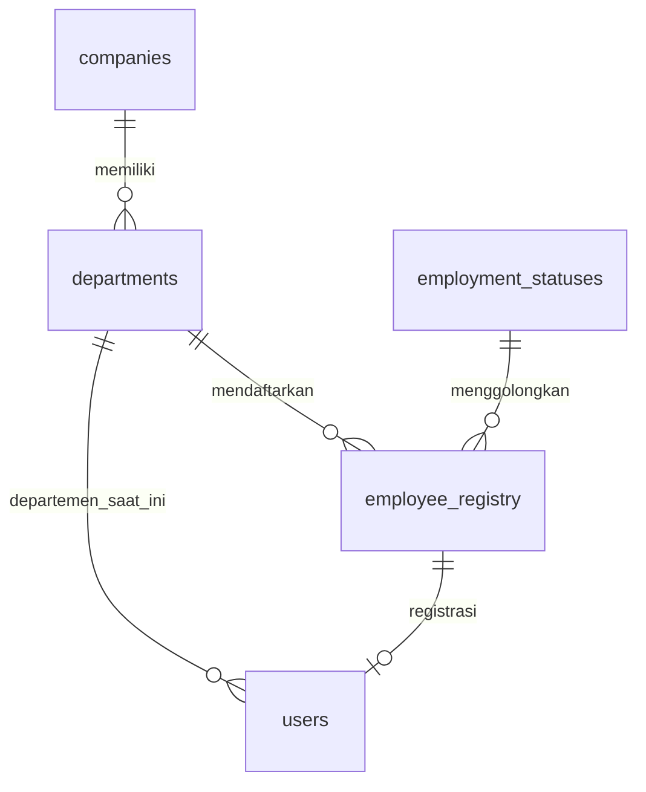
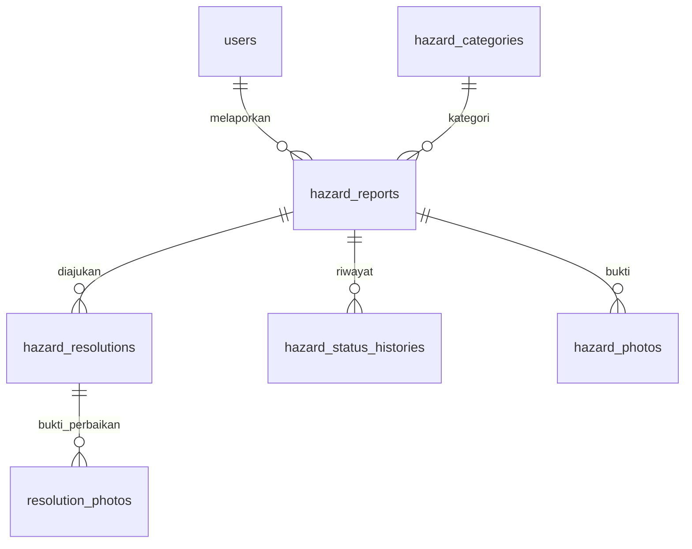
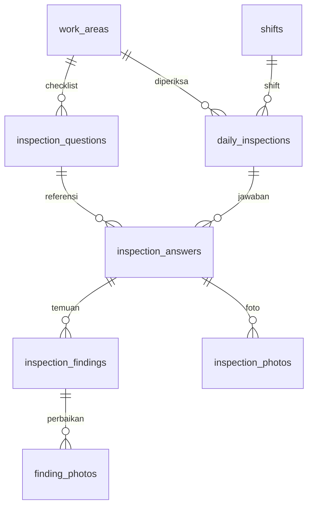
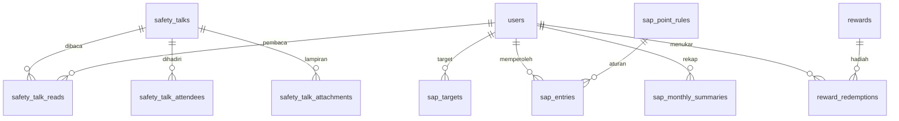

# Relasi database SafeTrack

Diagram ringkas per modul. Lihat migrations untuk seluruh foreign key dan atribut. Relasi user berulang diringkas agar terbaca.

## Identitas

## Hazard

## Inspeksi

## Safety Talk dan SAP

Notifications memakai struktur polymorphic bawaan Laravel. audit_logs menyimpan jenis/ID entitas serta snapshot sebelum/sesudah. sap_entries memakai activity/source_id untuk sumber lintas modul: integritasnya diperiksa service, bukan FK langsung.
